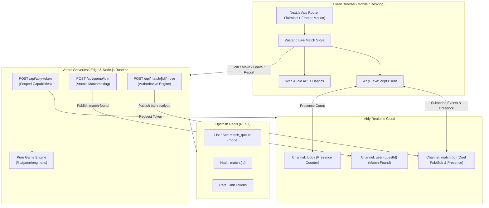

# 🏏 HandCricketOmegle

An Omegle-style, real-time 1v1 random matchmaking Hand Cricket game built for the modern web. Players connect anonymously as guests (e.g., `SwiftTiger42`), participate in an authoritative coin toss, and play simultaneous secret hand-pick deliveries resolved serverlessly with zero extra persistent server processes.

Deployable directly to **Vercel** with **Ably Pub/Sub** and **Upstash Redis**.

---

## 🌟 Features

- **Omegle-Style Matchmaking**: Instant 1v1 pairing via Upstash Redis atomic Lua queue pairing with guest IDs stored in `httpOnly` secure cookies.
- **Mutual 5-Second Ready Check**: High-visibility countdown modal verifying both players are active and focused before launching WebRTC video or match deliveries (REL-02).
- **Unlimited Search & Bot Warmup**: Indefinite matchmaking search with interactive "Warm Up vs Bot" practice directly in the waiting screen without losing queue position.
- **Endless Multi-Round Series**: Running series scoreboard with automatic toss role alternation (Game 1 $\rightarrow$ P1, Game 2 $\rightarrow$ P2) for continuous duels.
- **Stranger-to-Friend Bridge**: Convert any random stranger match into a persistent private friend duel with a shareable 6-character room code without stream interruption.
- **Server-Authoritative State Engine**: Pure, framework-agnostic reducer engine (`/lib/game/engine.ts`). Clients never receive an opponent's pick until both are locked in.
- **Screen Wake Lock & Visibility Recovery**: Screen Wake Lock API (`navigator.wakeLock`) prevents screen sleep during live matches, with auto-pause/resume on tab backgrounding (REL-04).
- **Ephemeral ICE / TURN Security**: Short-lived credentials generated server-side via `POST /api/ice`, completely eliminating client-side credential extraction (SEC-01).
- **Comprehensive Privacy & Safety**: 18+ age verification, zero video storage disclosure, mutual blocklist isolation, and automated 3-report 24-hour suspension.
- **Accessibility & A11y**: Full keyboard hotkeys (`1`–`6` picks, `Enter`/`Space` lock-in), minimum 64px tap targets, and full `@media (prefers-reduced-motion: reduce)` support.
- **Deployment Ready**: Fully deployable to Vercel with zero extra servers. See [DEPLOYMENT.md](file:///d:/HandCricketOmegle/DEPLOYMENT.md) for full setup instructions.

---

## 🏗️ Architecture



---

## 📁 Project Structure

```text
├── .github/
│   └── workflows/
│       └── ci.yml               # GitHub Actions (Lint, Typecheck, Test, Build)
├── public/
│   ├── ably.min.js              # Standalone client bundle for Ably Pub/Sub
│   ├── favicon.ico
│   ├── manifest.json            # PWA web manifest
│   ├── robots.txt
│   └── og-image.png             # Social OpenGraph banner
├── src/
│   ├── app/
│   │   ├── api/
│   │   │   ├── ably-token/      # Token auth route handler
│   │   │   ├── health/          # System health check route
│   │   │   ├── match/[id]/
│   │   │   │   ├── leave/       # Forfeits and match exits
│   │   │   │   ├── move/        # Authoritative ball & toss submissions
│   │   │   │   ├── react/       # Safe emoji reaction broadcasts
│   │   │   │   └── report/      # Abuse incident logging
│   │   │   ├── queue/
│   │   │   │   ├── join/        # Matchmaking queue entry & bot fallback
│   │   │   │   └── leave/       # Matchmaking queue cancellation
│   │   │   └── session/         # Guest identity generator & cookie manager
│   │   ├── admin/reports/       # Reports administration dashboard
│   │   ├── play/
│   │   │   ├── bot/             # Instant offline/practice bot arena
│   │   │   └── match/           # Direct match portal
│   │   ├── privacy/             # Privacy & terms
│   │   ├── room/[code]/         # Private friend room matches
│   │   ├── globals.css          # Theme styles & cricket animations
│   │   ├── layout.tsx           # PWA metadata, fonts, script tags
│   │   ├── page.tsx             # Main arena controller
│   │   └── sitemap.ts           # Dynamic sitemap
│   ├── components/
│   │   ├── BallStrip.tsx        # Over-by-over ball history timeline
│   │   ├── EmojiReactions.tsx   # 6-emoji floating reactions bar
│   │   ├── Hand.tsx             # Animated SVG/CSS cricket hand visual
│   │   ├── HandTile.tsx         # Duel card with mystery, locked, and reveal states
│   │   ├── HowToPlayModal.tsx   # Interactive rules guide modal
│   │   ├── InningsBreakScreen.tsx # Mid-match score & chase target summary
│   │   ├── LandingScreen.tsx    # Anonymous preview, mode selector, CTA
│   │   ├── LiveMatchScreen.tsx  # Central 1v1 battle arena
│   │   ├── Navbar.tsx           # Live player count, sound toggle, status
│   │   ├── NumberPad.tsx        # 1-6 touch numeric keypad
│   │   ├── ReportModal.tsx      # Opponent reporting modal
│   │   ├── ResultBanner.tsx     # Victory, defeat, tie & forfeit banner
│   │   ├── ScoreBar.tsx         # Score, wickets, run rate, target bar
│   │   ├── SearchingOverlay.tsx # Radar pulse matchmaking with bot fallback
│   │   ├── TimerRing.tsx        # Circular SVG 10s countdown timer
│   │   └── TossScreen.tsx       # Odd/Even coin toss and Bat/Bowl decision
│   ├── lib/
│   │   ├── client/
│   │   │   ├── ablyClient.ts    # Browser Ably loader
│   │   │   ├── audio.ts         # Synthesized Web Audio & Haptics
│   │   │   └── confetti.ts      # Victory celebratory confetti
│   │   ├── game/
│   │   │   ├── engine.ts        # Pure reducer-style game engine
│   │   │   └── types.ts         # Shared state & event typings
│   │   ├── store/
│   │   │   └── liveMatchStore.ts# Zustand orchestrator
│   │   ├── env.ts               # Zod environment variable validator
│   │   ├── names.ts             # Random guest moniker generator
│   │   ├── ratelimit.ts         # Upstash rate limiter utility
│   │   └── redis.ts             # Upstash Redis client
│   └── styles/
│       └── tokens.css           # Pitch green, cricket leather red, amber tokens
├── tests/
│   ├── e2e/
│   │   └── smoke.spec.ts        # Playwright E2E smoke tests
│   ├── engine.test.ts           # 21 unit tests for game rules & edge cases
│   └── game.test.ts             # Validation unit tests
├── .env.example                 # Template for required environment keys
├── next.config.mjs              # Security headers & external packages
├── package.json
├── playwright.config.ts         # E2E test runner configuration
├── tsconfig.json                # Strict TypeScript configuration
├── vercel.json                  # Mumbai (bom1) regional compute config
└── vitest.config.ts             # Vitest unit test runner config
```

---

## 🚀 Getting Started

### 1. Prerequisites

- [Node.js 20+](https://nodejs.org)
- [npm](https://www.npmjs.com)

### 2. Free-Tier Account Setup

#### A. Ably Realtime (Pub/Sub)
1. Go to [Ably.com](https://ably.com) and create a free account.
2. Create an application (e.g. `HandCricketOmegle`).
3. Under the **API Keys** tab, copy the **Root** API key (format: `app-id.key-id:key-secret`).

#### B. Upstash Redis (Serverless State & Queues)
1. Go to [Upstash.com](https://upstash.com) and create a free account.
2. Click **Create Database**:
   - Name: `hand-cricket-redis`
   - Region: Select closest to your users (e.g. `ap-south-1` / Mumbai or `us-east-1`).
   - Eviction: Enabled (volatile).
3. Under **REST API**, copy:
   - `UPSTASH_REDIS_REST_URL` (starts with `https://`)
   - `UPSTASH_REDIS_REST_TOKEN`

### 3. Local Installation

```bash
# Clone the repository
git clone https://github.com/your-username/HandCricketOmegle.git
cd HandCricketOmegle

# Install dependencies
npm install

# Configure environment variables
cp .env.example .env.local
```

Fill in `.env.local`:
```env
ABLY_API_KEY=your_actual_ably_key
UPSTASH_REDIS_REST_URL=https://your-database.upstash.io
UPSTASH_REDIS_REST_TOKEN=your_actual_token
NEXT_PUBLIC_APP_URL=http://localhost:3000
```

### 4. Running the Development Server

```bash
npm run dev
```

Open [http://localhost:3000](http://localhost:3000) in your browser.

---

## 🧪 Testing & Validation

```bash
# 1. Typecheck the entire codebase
npx tsc --noEmit

# 2. Run ESLint
npm run lint

# 3. Run all Vitest Unit Tests (70 tests covering all game engine logic)
npm test

# 4. Run Playwright E2E Smoke Tests
npm run test:e2e

# 5. Validate the production build bundle
npm run build
```

---

## 🚢 Deploying to Vercel

HandCricketOmegle is specifically engineered for zero-server deployment on Vercel's serverless infrastructure.

### Step-by-Step Vercel Deployment

1. **Push your code** to GitHub or GitLab.
2. Open the [Vercel Dashboard](https://vercel.com/dashboard) and click **"Add New..." > "Project"**.
3. Import your `HandCricketOmegle` repository.
4. In the **Configure Project** screen:
   - **Framework Preset**: Next.js
   - **Root Directory**: `./`
5. Expand the **Environment Variables** section and add:
   | Key | Value | Description |
   | :--- | :--- | :--- |
   | `ABLY_API_KEY` | `your_ably_api_key` | Serverless token generation & event pub |
   | `UPSTASH_REDIS_REST_URL` | `https://...upstash.io` | REST endpoint for queues & matches |
   | `UPSTASH_REDIS_REST_TOKEN` | `your_upstash_token` | REST bearer token |
   | `NEXT_PUBLIC_APP_URL` | `https://your-domain.vercel.app` | Production canonical URL |
6. Click **Deploy**. Vercel will build and assign your production URL.

---

## 📋 Manual QA Checklist

### 1. Two Browser Tabs Stranger Match
1. Open [http://localhost:3000](http://localhost:3000) in **Tab A** (Regular window).
2. Open [http://localhost:3000](http://localhost:3000) in **Tab B** (Incognito window to guarantee separate cookies).
3. In Tab A, click **"FIND STRANGER MATCH"** (Sudden Death mode).
4. In Tab B, click **"FIND STRANGER MATCH"** (Sudden Death mode).
5. **Expected Outcome**:
   - Both tabs immediately exit searching and land on the **Toss Screen**.
   - Tab A is assigned P1 (calls Toss), Tab B is assigned P2 (picks number).
   - Once toss is resolved, winner chooses Bat or Bowl, and both smoothly transition to the **Live Match Screen**.

### 2. Simultaneous Pick & Secret Reveal
1. In Tab A (Batter), select number `4`. Notice Tab A shows `LOCKED IN 🔒` and Tab B shows `Opponent is Ready!`. Opponent's pick is **never visible**.
2. In Tab B (Bowler), select number `6`.
3. **Expected Outcome**:
   - 3-2-1 suspense animation triggers on both screens.
   - Hands flip: Tab A reveals `4`, Tab B reveals `6`.
   - Scoreboard updates to `4/0`, runs banner says `+4 RUNS`, bat strike sound plays.

### 3. Wicket & Chase Resolution
1. Have both players pick the same number (e.g., both pick `3`).
2. **Expected Outcome**:
   - Screen-shake animation triggers with a wooden wicket crash sound.
   - In Sudden Death (1 wicket), Innings 1 concludes and transitions to the **Innings Break Screen** displaying target `Target: 5 runs`.
   - Start 2nd Innings: Bowler and Batter switch roles.
   - If Tab B scores 5 or more, Tab B wins; if out before 5, Tab A wins. Confetti shoots across the screen on victory.

### 4. 10-Second Timer Auto-Pick Test
1. When a new ball starts, do not click any number.
2. Watch the circular SVG timer count down: green -> amber (3s) -> pulsing red (1s).
3. **Expected Outcome**:
   - At 0 seconds, the client automatically executes an auto-pick (1–6).
   - The move is safely sent to the authoritative server and locks in without stalling the match.

### 5. 12-Second Bot Fallback Test
1. In a single browser tab, click **"FIND STRANGER MATCH"**.
2. Do not open any other tab. Wait 12 seconds on the searching screen.
3. **Expected Outcome**:
   - A pulsing card appears: *"No opponents in queue. Play vs Server Bot?"*.
   - Clicking **"Play vs Bot"** immediately pairs with an AI opponent (clearly labeled with a 🤖 badge).

### 6. Disconnect & Forfeit Test
1. Pair Tab A and Tab B into an active match.
2. Close Tab B.
3. Tab A detects presence leave:
   - A warning banner appears: *"Opponent disconnected! Waiting 15s before forfeit..."*.
4. If Tab B does not return within 15 seconds, Tab A automatically wins by forfeit with full match resolution.

---

## 🔒 Security & Abuse Prevention

- **Authoritative Validation**: Move inputs are strictly validated with Zod (`1 <= pick <= 6`). Duplicate submissions for the same delivery are rejected via ball index tracking.
- **Strict Content Security Policy (CSP)**: Defined in `next.config.mjs` including `frame-ancestors 'none'`, script source restrictions, and referrer policies.
- **Rate Limiting**: Every API route enforces sliding window rate limits via `@upstash/ratelimit`.
- **Scoped Token Credentials**: Clients never receive the master `ABLY_API_KEY`. The `/api/ably-token` endpoint generates short-lived, least-privilege tokens scoped only to `match:{id}` and `user:{guestId}`.

---

## 📄 License

MIT License. Built with ❤️ for cricket fans around the world.
