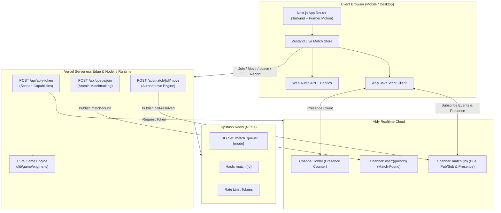

# 🏏 HandCricketOmegle

An Omegle-style, real-time 1v1 random matchmaking Hand Cricket game built for the modern web. Players connect anonymously as guests (e.g., `SwiftTiger42`), participate in an authoritative coin toss, and play simultaneous secret hand-pick deliveries resolved serverlessly with zero extra persistent server processes.

Deployable directly to **Vercel** with **Ably Pub/Sub** and **Upstash Redis**.

---

## 🌟 Features

- **Omegle-Style Matchmaking**: Instant 1v1 pairing via Upstash Redis atomic Lua queue pairing with guest IDs stored in `httpOnly` secure cookies.
- **Live Video Arena (WebRTC P2P)**: Peer-to-peer WebRTC video + audio over serverless Ably signaling with STUN/TURN relay fallbacks (Metered, Twilio, Cloudflare Calls).
- **On-Device Computer Vision Gestures**: MediaPipe HandLandmarker running 100% locally in browser via WebAssembly/WebGL. Zero video frames sent to servers.
- **Indian Hand Cricket Gestures**: 1 to 5 extended fingers = 1 to 5 runs; 6 runs = Thumbs-Up (fist with thumb extended). ~300ms gesture stability window, 3-2-1 countdown lock, and AR hand skeleton canvas overlay.
- **Endless Mode**: No over limits! Bat until you are out. Features live strike streaks (🔥), runs/balls HUD, milestone celebrations at 25/50/100 runs, and sudden-death 1-ball super-over tiebreakers.
- **Endless Pro & Solo Bot**: Support for 1-wicket (default) or 3-wicket ("Endless Pro") variants, plus Solo Endless mode with localStorage personal best and `/api/leaderboard` integration.
- **Zero Video Storage Guarantee**: Strict privacy pledge with pre-match camera test, 18+ age verification, video blur toggle, and instant block/report/skip controls.
- **Fail-Safe Tap Fallback**: Seamless manual tap buttons (1–6) available at all times, auto-suggested if no hand is detected for 3 seconds.
- **Server-Authoritative State Engine**: Pure, framework-agnostic reducer engine (`/lib/game/engine.ts`). Clients never receive an opponent's pick until both are locked in.
- **Screen Wake Lock & Tactical Pause**: Screen Wake Lock API (`navigator.wakeLock`) prevents screen sleep during live matches, with tactical pause support for marathon sessions.
- **Ephemeral ICE / TURN Security**: Short-lived credentials generated server-side via `POST /api/ice`, completely eliminating client-side credential extraction.
- **Accessibility & A11y**: Full keyboard hotkeys (`1`–`6` picks, `Enter`/`Space` lock-in), minimum 64px tap targets, and full `@media (prefers-reduced-motion: reduce)` support.
- **Deployment Ready**: Fully deployable to Vercel with zero extra servers. See [DEPLOYMENT.md](file:///d:/HandCricketOmegle/DEPLOYMENT.md) for full setup instructions.

---

## 🏗️ Architecture



---

## 📁 Project Structure

```text
├── .github/
│   └── workflows/
│       └── ci.yml               # GitHub Actions (Lint, Typecheck, Test, Build)
├── public/
│   ├── ably.min.js              # Standalone client bundle for Ably Pub/Sub
│   ├── favicon.ico
│   ├── manifest.json            # PWA web manifest
│   ├── robots.txt
│   └── og-image.png             # Social OpenGraph banner
├── src/
│   ├── app/
│   │   ├── api/
│   │   │   ├── ably-token/      # Token auth route handler
│   │   │   ├── health/          # System health check route
│   │   │   ├── match/[id]/
│   │   │   │   ├── leave/       # Forfeits and match exits
│   │   │   │   ├── move/        # Authoritative ball & toss submissions
│   │   │   │   ├── react/       # Safe emoji reaction broadcasts
│   │   │   │   └── report/      # Abuse incident logging
│   │   │   ├── queue/
│   │   │   │   ├── join/        # Matchmaking queue entry & bot fallback
│   │   │   │   └── leave/       # Matchmaking queue cancellation
│   │   │   └── session/         # Guest identity generator & cookie manager
│   │   ├── admin/reports/       # Reports administration dashboard
│   │   ├── play/
│   │   │   ├── bot/             # Instant offline/practice bot arena
│   │   │   └── match/           # Direct match portal
│   │   ├── privacy/             # Privacy & terms
│   │   ├── room/[code]/         # Private friend room matches
│   │   ├── globals.css          # Theme styles & cricket animations
│   │   ├── layout.tsx           # PWA metadata, fonts, script tags
│   │   ├── page.tsx             # Main arena controller
│   │   └── sitemap.ts           # Dynamic sitemap
│   ├── components/
│   │   ├── BallStrip.tsx        # Over-by-over ball history timeline
│   │   ├── EmojiReactions.tsx   # 6-emoji floating reactions bar
│   │   ├── Hand.tsx             # Animated SVG/CSS cricket hand visual
│   │   ├── HandTile.tsx         # Duel card with mystery, locked, and reveal states
│   │   ├── HowToPlayModal.tsx   # Interactive rules guide modal
│   │   ├── InningsBreakScreen.tsx # Mid-match score & chase target summary
│   │   ├── LandingScreen.tsx    # Anonymous preview, mode selector, CTA
│   │   ├── LiveMatchScreen.tsx  # Central 1v1 battle arena
│   │   ├── Navbar.tsx           # Live player count, sound toggle, status
│   │   ├── NumberPad.tsx        # 1-6 touch numeric keypad
│   │   ├── ReportModal.tsx      # Opponent reporting modal
│   │   ├── ResultBanner.tsx     # Victory, defeat, tie & forfeit banner
│   │   ├── ScoreBar.tsx         # Score, wickets, run rate, target bar
│   │   ├── SearchingOverlay.tsx # Radar pulse matchmaking with bot fallback
│   │   ├── TimerRing.tsx        # Circular SVG 10s countdown timer
│   │   └── TossScreen.tsx       # Odd/Even coin toss and Bat/Bowl decision
│   ├── lib/
│   │   ├── client/
│   │   │   ├── ablyClient.ts    # Browser Ably loader
│   │   │   ├── audio.ts         # Synthesized Web Audio & Haptics
│   │   │   └── confetti.ts      # Victory celebratory confetti
│   │   ├── game/
│   │   │   ├── engine.ts        # Pure reducer-style game engine
│   │   │   └── types.ts         # Shared state & event typings
│   │   ├── store/
│   │   │   └── liveMatchStore.ts# Zustand orchestrator
│   │   ├── env.ts               # Zod environment variable validator
│   │   ├── names.ts             # Random guest moniker generator
│   │   ├── ratelimit.ts         # Upstash rate limiter utility
│   │   └── redis.ts             # Upstash Redis client
│   └── styles/
│       └── tokens.css           # Pitch green, cricket leather red, amber tokens
├── tests/
│   ├── e2e/
│   │   └── smoke.spec.ts        # Playwright E2E smoke tests
│   ├── engine.test.ts           # 21 unit tests for game rules & edge cases
│   └── game.test.ts             # Validation unit tests
├── .env.example                 # Template for required environment keys
├── next.config.mjs              # Security headers & external packages
├── package.json
├── playwright.config.ts         # E2E test runner configuration
├── tsconfig.json                # Strict TypeScript configuration
├── vercel.json                  # Mumbai (bom1) regional compute config
└── vitest.config.ts             # Vitest unit test runner config
```

---

## 🚀 Getting Started

### 1. Prerequisites

- [Node.js 20+](https://nodejs.org)
- [npm](https://www.npmjs.com)

### 2. Free-Tier Account Setup

#### A. Ably Realtime (Pub/Sub)
1. Go to [Ably.com](https://ably.com) and create a free account.
2. Create an application (e.g. `HandCricketOmegle`).
3. Under the **API Keys** tab, copy the **Root** API key (format: `app-id.key-id:key-secret`).

#### B. Upstash Redis (Serverless State & Queues)
1. Go to [Upstash.com](https://upstash.com) and create a free account.
2. Click **Create Database**:
   - Name: `hand-cricket-redis`
   - Region: Select closest to your users (e.g. `ap-south-1` / Mumbai or `us-east-1`).
   - Eviction: Enabled (volatile).
3. Under **REST API**, copy:
   - `UPSTASH_REDIS_REST_URL` (starts with `https://`)
   - `UPSTASH_REDIS_REST_TOKEN`

### 3. Local Installation

```bash
# Clone the repository
git clone https://github.com/your-username/HandCricketOmegle.git
cd HandCricketOmegle

# Install dependencies
npm install

# Configure environment variables
cp .env.example .env.local
```

Fill in `.env.local`:
```env
ABLY_API_KEY=your_actual_ably_key
UPSTASH_REDIS_REST_URL=https://your-database.upstash.io
UPSTASH_REDIS_REST_TOKEN=your_actual_token
NEXT_PUBLIC_APP_URL=http://localhost:3000

# Optional WebRTC TURN Server Fallbacks (Google STUN is active by default)
# Option A: Metered TURN (metered.ca)
METERED_API_KEY=your_metered_api_key
METERED_APP_NAME=your_metered_app_name

# Option B: Twilio Network Traversal (twilio.com)
TWILIO_ACCOUNT_SID=your_twilio_sid
TWILIO_AUTH_TOKEN=your_twilio_auth_token

# Option C: Coturn / Cloudflare Calls HMAC
COTURN_URL=turn:turn.yourdomain.com:3478
COTURN_SECRET=your_turn_shared_secret
```

### 4. Running the Development Server

```bash
npm run dev
```

Open [http://localhost:3000](http://localhost:3000) in your browser.

---

## 🧪 Testing & Validation

```bash
# 1. Typecheck the entire codebase
npx tsc --noEmit

# 2. Run ESLint
npm run lint

# 3. Run all Vitest Unit Tests (131 tests covering engine, gesture detection, and endless mode)
npm test

# 4. Run Playwright E2E Smoke Tests
npm run test:e2e

# 5. Validate the production build bundle
npm run build
```

---

## 🚢 Deploying to Vercel

HandCricketOmegle is specifically engineered for zero-server deployment on Vercel's serverless infrastructure.

### Step-by-Step Vercel Deployment

1. **Push your code** to GitHub or GitLab.
2. Open the [Vercel Dashboard](https://vercel.com/dashboard) and click **"Add New..." > "Project"**.
3. Import your `HandCricketOmegle` repository.
4. In the **Configure Project** screen:
   - **Framework Preset**: Next.js
   - **Root Directory**: `./`
5. Expand the **Environment Variables** section and add:
   | Key | Value | Description |
   | :--- | :--- | :--- |
   | `ABLY_API_KEY` | `your_ably_api_key` | Serverless token generation & event pub |
   | `UPSTASH_REDIS_REST_URL` | `https://...upstash.io` | REST endpoint for queues & matches |
   | `UPSTASH_REDIS_REST_TOKEN` | `your_upstash_token` | REST bearer token |
   | `NEXT_PUBLIC_APP_URL` | `https://your-domain.vercel.app` | Production canonical URL |
   | `METERED_API_KEY` | *(Optional)* | Ephemeral TURN relay fallback |
   | `METERED_APP_NAME` | *(Optional)* | Metered app domain |
6. Click **Deploy**. Vercel will build and assign your production URL.

---

## 📋 Manual QA Checklist

### 1. Two Browser / Two Device Matchmaking & Video Call
1. Open [http://localhost:3000](http://localhost:3000) on **Device/Tab A** (Regular window).
2. Open [http://localhost:3000](http://localhost:3000) on **Device/Tab B** (Incognito window or phone).
3. On Tab A, click **"FIND STRANGER MATCH"**. The **Camera Check & Consent Modal** opens:
   - Verify camera preview starts up.
   - Check the **"Blur my video until match starts"** toggle.
   - Click **"Accept & Continue"**.
4. Repeat step 3 on Tab B.
5. **Expected Outcome**:
   - Both tabs pair immediately and transition through the mutual ready-check and toss.
   - Once the match starts, Tab A sees Tab B's large video, and vice versa.
   - Each player's local stream displays as a PiP in the corner.
   - Mic mute/unmute, Camera toggle, Flip Camera, and Blur Video controls respond instantly.

### 2. Camera Finger Gestures & Live AR Skeleton
1. Position your hand clearly in front of the camera with good lighting.
2. Hold up **1 to 5 fingers**:
   - The detected number badge updates with confidence (e.g., `3 ✋`).
   - The AR hand skeleton canvas draws landmarks and joints in real time.
3. Hold up a **thumbs-up** (closed fist, thumb extended):
   - The detected number badge updates to `6 🏏` (Indian Hand Cricket convention).
4. Watch the 3-2-1 turn countdown:
   - When the countdown reaches "SHOW!", the stable reading locks in.
   - The pick is submitted as a secret pick. Once both players submit, the reveal animation triggers.
5. **Low-Light / 3s Auto-Suggest Fallback**:
   - Move your hand out of frame for 3 seconds.
   - An amber toast appears: *"Hand not detected? Tap buttons below!"*.
   - Tap any number (1–6) on the numeric keypad to pick immediately.

### 3. Endless Mode (1v1 Match)
1. On the landing screen, select **"Endless Mode"** (1 wicket or 3 wickets "Endless Pro").
2. Match with an opponent or friend via room code.
3. **Batter's Turn**:
   - Batter keeps scoring every ball (runs added = number picked).
   - The live HUD tracks Runs, Balls Faced, and Strike Streak (🔥).
   - Milestone celebratory animations trigger when crossing 25, 50, and 100 runs.
   - Innings ends only when the bowler picks the exact same number (Wicket!).
4. **Chaser's Turn**:
   - Chaser sees a prominent live **Target** and **Runs Needed** display.
   - The chase ends the exact ball the chaser exceeds the target.
   - If scores are tied when the chaser loses their final wicket, the match triggers a sudden-death **1-Ball Super-Over Decider**!

### 4. Solo Endless Mode (vs Practice Bot)
1. Select **Endless Mode**, then click **"Practice vs Bot"**.
2. Bat against the AI bot until out.
3. Upon getting out:
   - The summary screen displays final Runs, Balls Faced, Strike Rate, 4s, 6s, and Highest Streak.
   - Personal best is stored locally in `localStorage` (`hand_cricket_endless_pb`).
   - Scores are submitted to `/api/leaderboard` for daily and all-time rankings.

### 5. Tactical Pause & Disconnect Handling
1. During an Endless match, tap the **Pause** icon on the video controls bar.
2. A tactical pause banner displays: *"Tactical Pause active"*.
3. Tap **Resume** to continue play.
4. If a player disconnects or closes their tab:
   - The 15-second forfeit timer starts.
   - If the player fails to reconnect within 15 seconds, the remaining player is awarded a forfeit win.

---

## 🔒 Security & Abuse Prevention

- **Authoritative Validation**: Move inputs are strictly validated with Zod (`1 <= pick <= 6`). Duplicate submissions for the same delivery are rejected via ball index tracking.
- **Strict Content Security Policy (CSP)**: Defined in `next.config.mjs` including `frame-ancestors 'none'`, script source restrictions, and referrer policies.
- **Rate Limiting**: Every API route enforces sliding window rate limits via `@upstash/ratelimit`.
- **Scoped Token Credentials**: Clients never receive the master `ABLY_API_KEY`. The `/api/ably-token` endpoint generates short-lived, least-privilege tokens scoped only to `match:{id}` and `user:{guestId}`.

---

## 📄 License

MIT License. Built with ❤️ for cricket fans around the world.
